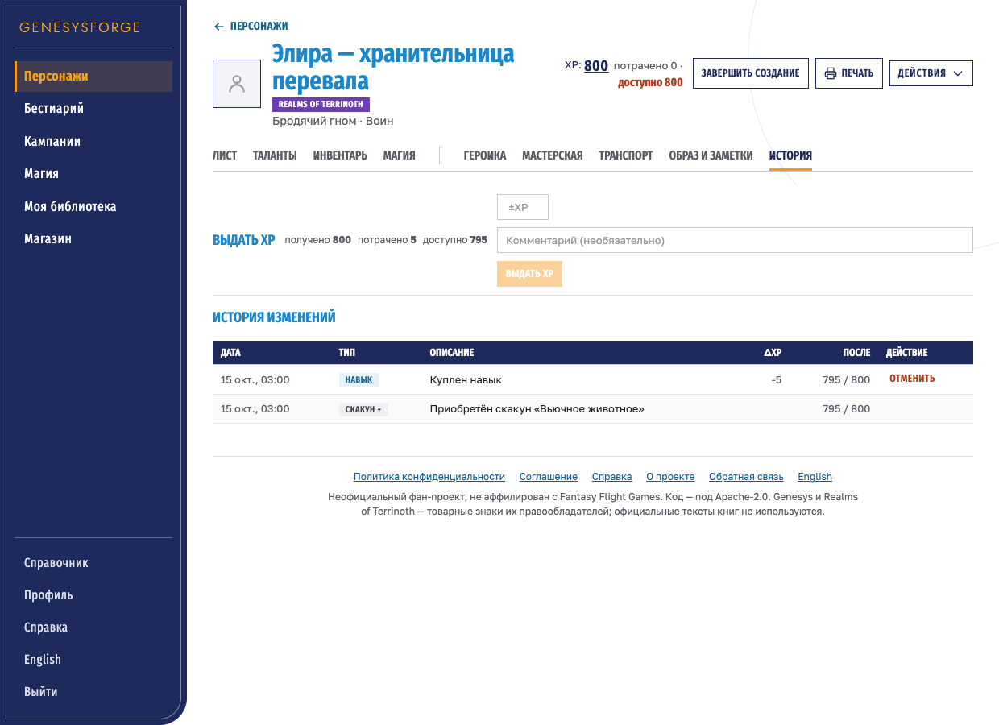
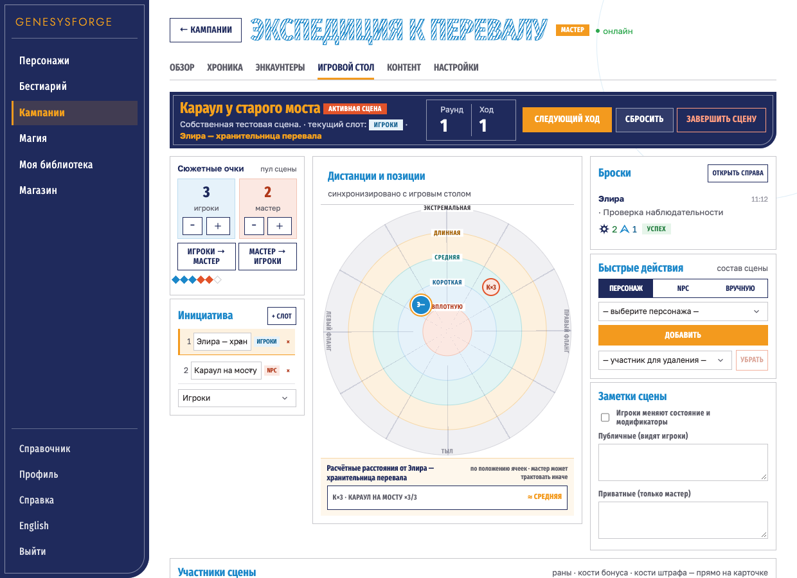
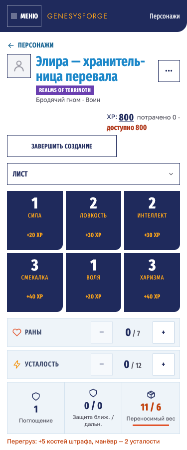

# GEN-V5-14: исправления замечаний по дизайну

Дата: 14.10.2026; исправления ревью — 15.10.2026. [ТЗ](../../../redesign_v5_tz/TZ_design_remarks_v5.md),
[план](../../../roadmap/tasks/gen-v5-14-design-remarks.md),
[PR #296](https://github.com/Giviruk/GenesysForgeClaude/pull/296).
Все исправления выполняются в `feature/gen-v5-14-design-remarks` по прямому указанию пользователя.

## Сопоставление с ТЗ

| Пункты | Результат |
| --- | --- |
| D-01, D-19 | Строки сетки талантов не растягиваются правой колонкой; купленные таланты идут сразу за пирамидой. Доступный каталог прокручивается отдельно; фильтры переносятся, показывают точки тиров, карточки имеют квадрат тира. |
| D-02, D-13 | `overflow:clip` сохраняет обрезку декора без поломки sticky. Мобильная шапка начинается у верхнего края, содержит видимую подпись «Меню» и отступ до контента. Раны и стресс карточки собраны в компактную строку с промежутком 16 px. |
| D-03, D-05, D-07 | Монеты, кубики, ссылки, изображения и плюсы используют локальные SVG. Первичная загрузка показывает логотип по центру и полосу загрузки; переход на ленивую страницу сохраняет каркас и показывает скелетон контента. |
| D-04, D-46 | Таблица участников занимает всю ширину под содержанием сцены; инициатива располагается ниже. Действия компактные и доступны без боковой прокрутки. Имена обрезаются с многоточием; цвет NPC берётся из его вида, имена сцен и счётчики укрупнены по ТЗ. |
| D-06, D-08, D-10, D-11 | Общая шкала размеров контролов и текста; чипы с точками и читаемыми счётчиками. Предупреждения используют `--warn-ink`; пустые состояния — 14 px. Мобильные кнопки сохраняют область нажатия 44 px. |
| D-09 | Шапки листа используют `localizedName`. Полные цитируемые имена в истории разрешаются через существующий справочник. Навыки транспорта, метаданные героики и таланты NPC локализованы; неизвестные пользовательские имена сохраняются. |
| D-12, D-14, D-18 | Управление карточкой персонажа — текстом; уменьшен отступ после XP. В шапке листа выровнены XP, печать и меню действий. На телефоне меню стоит рядом с именем; селект раздела сохраняет доступную подпись, скрытую визуально. |
| D-15 | У критических ранений отдельный красный счётчик, линия справа и сворачиваемая форма добавления. Показывается диапазон d100 и сложность символами. «Снять» имеет спокойный цвет. |
| D-16, D-17, D-20…D-24 | Перегруз окрашивает шкалу красным, достижение порога — оранжевым. Покупка характеристики компактна. У предметов нет ведущего разделителя; количество — групповой степпер, состояние использования перенесено к имени, повреждение — компактный селект. Деньги и вес имеют SVG и шкалу. |
| D-25…D-30 | Магазин инвентаря содержит квадрат категории и компактные действия. Действия магии не разрываются посреди слова; термины в кавычках не имеют лишних отступов. Сложность показана glyph-символами, чекбоксы оформлены; итог и описания компактны, длинный текст раскрывается, источник доступен в строке. |
| D-31…D-33 | Мета героики разделяет короткое значение и пояснение, имеет одну рамку. Описания уровней и кнопки приведены к шкале; новая сессия — кнопка, вторичные эффекты — компактные строки с одной ценой. |
| D-34, D-35 | У выбранной основы улучшения есть тег; иконка соответствует виду предмета. Каталог имеет шапку и кошелёк. Цели ремесла выровнены сверху, редкость не разрывается от числа, длинный список прокручивается отдельно. |
| D-36…D-38 | Имя транспорта — 21 px, тёмное, с пунктирной линией; статы — 2×2, характеристики — регулярная сетка. Погрузка оформлена пунктирными чипами, конюшня имеет компактные действия и раскрытие сведений. |
| D-39, D-40 | Иконки заметки стоят справа от заголовка, мотивации не имеют ручки изменения размера. Выдача XP и итоговые числа собраны горизонтально. История имеет теги для ремесла и улучшений, короткие даты и выровненную отмену. |
| D-41…D-45, D-47 | Блоки обзора имеют высоту по содержимому. Сюжетные очки — две плитки со степперами и стрелками, заметки добавляются через раскрытие формы. Связь показана точкой отдельно от роли; пустое описание не отображается. Хроника имеет полосу-шапку и согласованную типографику. Правая колонка стола расширена, подписи модификаторов сокращены, раунд и ход разделены. Заголовки контента и строки систем компактны. |
| D-48…D-51 | Фильтры бестиария компактны и имеют читаемые счётчики. Выбранный NPC выделяется оранжевой подложкой и левой полосой. Подписи статблока видны целиком; характеристики сокращены и не меньше 11 px. Редактор и черновик используют согласованные подписи, предпросмотр не растягивается пустой рамкой. |
| D-52…D-54 | Действия библиотеки располагаются справа от заголовка. Первый визит выбирает систему с контентом; ручной выбор сохраняется. Технические названия систем заменены только при отображении, наборы и действия элементов компактны. |
| D-55, D-56 | Товар имеет полосу категории и плашку цены с монетой; категория имеет точку у счётчика. Названия в фактах не разрываются, редкость окрашена по шкале, количество — степпер. Описание, состоящее только из уже показанных качеств, не дублируется. |

Отдельное действие «Лечить» для критических ранений: **Not found in current codebase**.
Сохранён существующий вызов снятия ранения; новая игровая механика не добавлялась.

## Проверки первого прохода 14.10.2026

Проверяются все вкладки листа, обзор/хроника/стол/энкаунтеры/контент кампании,
карточка NPC и оба редактора, библиотека, общий магазин; 1240 / 768 / 375 px, RU/EN.
Существующая приёмка дополнительно покрывает 1440 и 1024 px, покупки, keyboard navigation
и печатные колонки. Проверки выполняются в локальном Chromium через установленный Chrome.

- [x] `npm run lint`
- [x] `npm test -- --maxWorkers=2` — 686 тестов в 82 файлах, все успешны
- [x] `npm run build`
- [x] Полный набор Playwright: 64 сценария; подтверждены все 60 применимых сценариев, 4 условных пропуска. В полном запуске прошли 58 сценариев; после исправления асинхронных ожиданий весь `redesign-followup.spec.ts` повторно прошёл (6/6).
- [x] `git diff --check`
- [x] Декларации `@media print` и компоненты печатного экспорта не изменены.

Зависимости использованы из существующих `node_modules`, без установки и изменения версий.
Первый проход не менял backend/API. По замечанию ревью R-15 добавлено nullable-поле `participants[].npcKind` в ответы энкаунтера (см. [API](../../api.md#encounters)): это устраняет загрузку всего бестиария ради цвета тега. Миграций нет; игровые правила, auth и seed не менялись.

## Снимки до/после

Исходная версия: `839e804`, код из исходной ветки PR до реализации.
На снимках собственный тестовый персонаж. Книжная проза закрыта серыми масками;
видимы только интерфейс, названия и структурные данные. Полные локальные снимки приёмки
в `frontend/test-results/` не коммитятся.

Таланты, 1240 px — купленные таланты доступны сразу под пирамидой.

| До | После |
| --- | --- |
|  |  |

Мобильный лист, 375 px — шапка у верхнего края, меню рядом с именем, подпись селекта скрыта визуально.

| До | После |
| --- | --- |
|  |  |

Copyright-note: новых текстов официальных книг нет; описания справочников и seed не менялись.

Переключатели «скрыт»/«повержен» явно недоступны на время сохранения предыдущей правки участника; регрессионный тест проверяет их восстановление и следующую команду. Геометрия полей покупки сравнивается в одном снимке DOM после загрузки кошелька, с сохранением строгого допуска 1 px.

## Исправления ревью 15.10.2026

Все 15 замечаний в 14 inline-комментариях и нестабильный тест магазина учтены
в [чеклисте R-01…R-16](../../../roadmap/tasks/gen-v5-14-design-remarks.md#ревью-15102026).

| Замечания | Исправление и проверка |
| --- | --- |
| R-01, R-06, R-07 | Все 35 backend-действий имеют явные RU/EN подписи; неизвестное действие получает нейтральную подпись. Скакуны включены в мемоизированный Map по lowercase-имени. Unit-проверка сохраняет число чтений справочника при вводе XP и комментария; браузер проверяет локализованное имя скакуна. |
| R-02, R-03, R-04 | Кнопки сюжетных очков 24×24 desktop и 44×44 mobile. Стол: колонки 210 / flex / 290 px. Короткие строки истории с отменой и без имеют одинаковую высоту; отмена — текстовое действие 24 px. Геометрия проверяется Playwright. |
| R-05 | Непринятые пункты сначала возвращены в работу с точным остатком; общий GEN-V5-14 остаётся `[~]` до слияния. |
| R-08 | Внутренний Suspense показывает скелетон в каркасе. E2E задерживает chunk бестиария и проверяет видимый sidebar без полноэкранной заставки. |
| R-09, R-10 | Возвращено «Название и происхождение». Мета локализуется и разделяется один раз; «По умолчанию» сохранено, пустые пояснения исключены. |
| R-11, R-12, R-14 | Точки ограничены настоящими фильтрами категорий. Текстовые действия Fira Sans Extra Condensed 600 13 uppercase. Мобильный логотип Jost 300 14 px с трекингом .12em. |
| R-13 | Раскрытие текста появляется только при фактической обрезке двух строк. Источник виден маленькой ссылкой; дополнительные статы скакуна доступны отдельным действием «Характеристики». ResizeObserver и измерение при смене текста отслеживают переполнение; unit/E2E проверяют отсутствие пустых раскрытий. |
| R-15 | Все ответы detail передают вид связанного NPC, только для видимых участников. Один SQL projection по ID участников; ручной участник возвращает null. Удалён отдельный frontend-эффект загрузки всего списка; QuickBuild сохраняет свой запрос. API: 4/4; E2E проверяет один запрос списка и цвет из первого ответа detail. |
| R-16 | Контролируемые promises магазина завершаются в `act` до поиска тяжёлого каталога по accessible name; mocks сбрасывают реализации между тестами. Таймауты не увеличены. Полный Vitest: 691/691, 83 файла. |

Повторная проверка: lint и production build успешны; 691 Vitest, 773 Domain и 962 API успешны. Два PostgreSQL integration-теста условно пропущены в локальном запуске без отдельного test connection string.

Полный локальный Playwright: 65 сценариев, подтверждены все 61 применимый сценарий, 4 условных пропуска. В полном запуске 60 прошли, один переход завершился `ERR_ABORTED` во время пересборки локальной PWA. После стабилизации сборки весь `redesign-followup.spec.ts` прошёл повторно (6/6). Актуальный GitHub CI — в [Checks PR #296](https://github.com/Giviruk/GenesysForgeClaude/pull/296/checks).

## Снимки после ревью

Снимки production-сборки, RU. Книжная проза замаскирована при захвате страницы.
История использует две контролируемые строки (короткая покупка с отменой и скакун),
чтобы сравнить высоту при одинаковой ширине столбцов; остальные данные созданы через API.

| История: одинаковые строки и локализованный скакун | Героика: сохранён смысл меты и заголовок |
| --- | --- |
|  |  |

| Игровой стол: колонки 210 / flex / 290 | Мобильная шапка: Jost 14 px |
| --- | --- |
|  |  |
