# GEN-V5-15: замечания по дизайну, часть 2

15.10.2026. [ТЗ E-01…E-17](../../../redesign_v5_tz/TZ_design_remarks_v5_2.md),
[план](../../../roadmap/tasks/gen-v5-15-design-remarks-2.md),
[PR #297](https://github.com/Giviruk/GenesysForgeClaude/pull/297).
Все исправления находятся в исходной ветке `feature/gen-v5-15-design-remarks-2`.

## Сопоставление с ТЗ

| Пункт | Изменение и проверка |
| --- | --- |
| E-01 | Компоненты оплачиваются при старте; разрешение проекта повторно денег не списывает. Нехватка блокирует старт в UI и API. Отмена возвращает подтверждённое списание один раз; старые неоплаченные проекты не получают возврат. API-тесты и UI-сценарий оплаты/отмены. |
| E-02 | Сервер передаёт аддитивные `damageKind`/`damageValue`, клиент показывает «Сила +2» / «Brawn +2» и локализованную дистанцию. Дистанции атак NPC тоже используют общий форматтер. xUnit, RU/EN unit и браузерные проверки. |
| E-03 | Пять качеств с рейтингом: чипы до 28 px, поле рейтинга 44×24 px, удаление 20 px. Перенос целыми чипами; SVG вместо эмодзи меча. Геометрия проверяется на desktop/mobile. |
| E-04 | Все вложенные заголовки шапки модалки используют `--orange-on-navy`, мета — `--on-navy-muted`. Проверены вычисленные цвета в статблоке стола. |
| E-05 | Имени предмета отведён минимум 160 px; переключатель состояния переносится целиком. Обычный перенос слов и автоматические переносы по языку. |
| E-06 | Имя энкаунтера FSEC 600 28 px; видимость, тип и угроза собраны под ним в один ряд на desktop. На телефоне действия переходят ниже. |
| E-07 | У заголовка критических ранений удалён лишний `::after`, добавление прижато вправо. |
| E-08 | На ≤480 px карточки типа NPC идут в одну колонку; название 15 px без разрыва. Проверен мобильный шаг черновика. |
| E-09 | Тег набора занимает отдельную строку карточки, обрезается многоточием, полное имя доступно в `title`. |
| E-10 | Стол: 280 / flex / 290 px; круг до 380 px, на планшете до 420 px. Кнопки передачи очков без переносов. Бейдж слота перенесён под имя; проверено место для 20 символов, размеры и высоты колонок. |
| E-11 | Все 64 видимых нативных списка заменены общим `Select`: портал, клавиатура, typeahead, группы, disabled, required и FormData. Нативный элемент оставлен только скрытым внутри компонента. Обновлены unit/E2E-хелперы. |
| E-12 | Указанные бейджи и подписи имеют размер не меньше 11 px. |
| E-13 | Покупка таланта — «N XP · Купить/Buy»; печать — иконка 28 px (44 px на телефоне). Подписи действий и выдачи XP не переносятся. |
| E-14 | XP в карточке кампании без переноса; две кнопки действий остаются рядом, при нехватке ширины переходят вместе на следующую строку. |
| E-15 | Имена NPC допускают две строки; полное имя в `title`. |
| E-16 | Названия навыков допускают две строки в пределах 44 px; полные названия сохраняются в `title`. |
| E-17 | Подписи `.bt-field-label` приведены к FSEC 600 12 UC, tracking .06em, `--label`. |

## Повторное ревью: 15 замечаний к 7242258

[Исходное ревью владельца](https://github.com/Giviruk/GenesysForgeClaude/pull/297#issuecomment-6197044921).

| № | Исправление и регрессия |
| --- | --- |
| 1 | Аудит старта и результата содержит ограниченные IDs/числа. Русские тексты до 2000 символов хранятся в проекте, не дублируются в varchar(2000). PostgreSQL проверяет фактический лимит. |
| 2 | Nullable PaidCost, миграция AddCraftingPaidCost. Неоплаченные проекты остаются null; точные платежи ранней реализации восстанавливаются из валидного JSON при миграции. Отмена не читает аудит. |
| 3 | craftingCancelled в истории RU/EN, projectId и сумма возврата; атомарно с кошельком и статусом. |
| 4 | Ошибка preview видна под кнопкой старта, очищается после успешного пересчёта. Unit-тест ошибки и восстановления. |
| 5 | EF concurrency tokens на Money и Status, общий 409 при устаревшей записи. PostgreSQL: два старта, две отмены и отмена/разрешение бесплатного проекта; проигравшая транзакция не оставляет проект, аудит или деньги. |
| 6 | Общий MoneyRules.Charge; сообщение содержит требуемую и доступную суммы. |
| 7 | База Select имеет специфичность нативного select. Контекстные размеры, рамки и шрифты применяются; общие правила кнопок исключают Select. Браузерные проверки магазина, инвентаря и быстрого добавления на столе. |
| 8 | Фокус остаётся у первого невалидного поля. Открывается только его меню; невалидный текстовый input сохраняет свой фокус. Unit и реальная форма создания персонажа. |
| 9 | Grid-span назначен видимому комбобоксу AddParticipant, скрытый native mirror не занимает колонку. |
| 10 | option.title переносится в DOM-опцию и native mirror; тест собственного описания качества. |
| 11 | Неиспользуемые options/placeholder удалены. Несовпадающее controlled value не превращается в первую чужую опцию FormData; required остаётся невалидным. |
| 12 | Scroll/resize не создаёт новое состояние при неизменной геометрии popup. |
| 13 | Явно показан тир следующего ранга рядом с базовым тиром и ценой. Проверено: два ранга тира 1 → следующий тир 3, 15 XP. |
| 14 | Непрерывные диапазоны <768, 768…<1240, ≥1240. Устранён старый display:flex на границе 48rem. Iframe проверяет 767.25 / 767.75 / 768.25 и 1239.25 / 1240.5 px с учётом округления viewport. |
| 15 | Удалены мёртвые правила .enc-scene-title>.enc-head-select; шапкой управляет .enc-scene-controls. |

Миграция проверена Up/Down/Up на отдельной PostgreSQL 17: строки проектов не удаляются.
Down удаляет только PaidCost; учёт оплаты требует повторного Up. Seed, книжные тексты,
версии пакетов, авторизация и CI/deployment не менялись.

## Проверки

- Backend после повторного ревью: 773 Domain, 965 API и проверки PostgreSQL с миграциями и гонками. Общий cleanup пула требует последовательного выполнения; три миграционных класса объединены в одну коллекцию и совместно прошли 3/3. Финальный набор ремесла — 26/26, включая PostgreSQL, миграцию и гонки.
- `Select`: 14 unit-тестов; формы, клавиатура, disabled, валидация required и модальный контейнер.
- Полный Vitest после повторного ревью: 710 тестов в 85 файлах; lint и production build успешны.
- Первичная приёмка Playwright до повторного ревью: 68 сценариев, подтверждены все 64 применимых, 4 условных пропуска. В полном запуске прошли 56; восемь проверок геометрии перенесены на новый Select и требования E-10 и прошли повторно. Новые три сценария после окончательной корректировки размеров талантов тоже повторно прошли.
- Firefox после повторного ревью: 4/4 новых сценария, RU/EN на 1240 / 1024 / 375 / 1440 px, карточки, диалог, оплата/отмена и печать таланта 28/44 px.
- После повторного ревью Chromium 5/5: RU/EN, оплата/возврат, форма с двумя обязательными списками, контекстные стили и дробные границы стола.
- Итоговый CI, включая оба режима контента: [Checks PR #297](https://github.com/Giviruk/GenesysForgeClaude/pull/297/checks).
- Печатные правила существующих экранов и компоненты экспорта сохранены; печатный popup и шеврон Select скрыты.

Для нативного `dialog.showModal()` меню остаётся внутри доступного поддерева диалога
и показывается в верхнем слое через Popover API. Обычное меню рендерится в `document.body`.
Это исключает блокировку кликов браузером и обрезку прокручиваемой областью диалога.
В браузерах проверены выбор мышью, Esc без закрытия диалога и возврат фокуса.
Открытый Select поглощает Esc; закрытый передаёт его родительскому окну.

Две колонки стола сохраняются до 1240 px: при более раннем переходе на три колонки
минимальные 280 + 340 + 290 px не помещаются рядом с боковой навигацией. Проверены
дробные размеры iframe 1239.25 и 1240.5 px с обеих сторон границы (браузер округляет внутренний viewport).

Ограничение среды: локальная macOS 13 не поддерживается актуальным Playwright WebKit;
Safari WebDriver возвращает `Operation not permitted`. Safari и реальные iOS/Android устройства
не проверены; мобильные размеры проверены в Chrome/Firefox. Проверка скринридером вручную не выполнялась;
ARIA-связи, выбранный пункт и управление фокусом покрыты автоматическими тестами.

Миграций и новых зависимостей нет. E-01 использует существующую атомарную запись аудита старта
с ID проекта и суммой списания; схема БД не меняется. Старые проекты без такой записи отменяются
без начисления денег. E-02 сохраняет прежнее строковое поле `damage` для старых клиентов.
Copyright-note: seed и описания справочников не менялись, новых текстов официальных книг нет.

Первый CI на Linux выявил две дополнительные ситуации: селектор библиотеки ожидал единственный
элемент после добавления тестового таланта, а полю инициативы не хватало места для имени.
Селектор привязан к нужному элементу; на desktop удаление перенесено в строку бейджа, имя занимает
всю оставшуюся ширину. Приёмка измеряет `scrollWidth/clientWidth` реальной подписи «Дозор у переправы ×3»
(20 символов), чтобы проверять отрисованный текст вместо оценки через canvas.

## Снимки до/после

Исходный frontend — `209792f` (PR до реализации, код приложения соответствует `f2f3bfd`).
Обе сборки используют одинаковую локальную API-сборку и самостоятельно созданные тестовые данные.
Книжная проза закрыта серыми масками при захвате; изображения проверены визуально.

Инвентарь, 1240 px: «Алебарда» помещается целиком, переключатель переносится ниже.

| До | После |
| --- | --- |
| 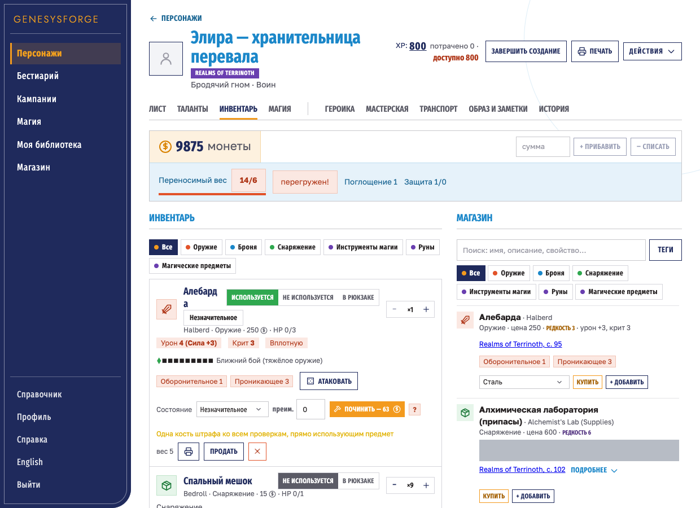 | 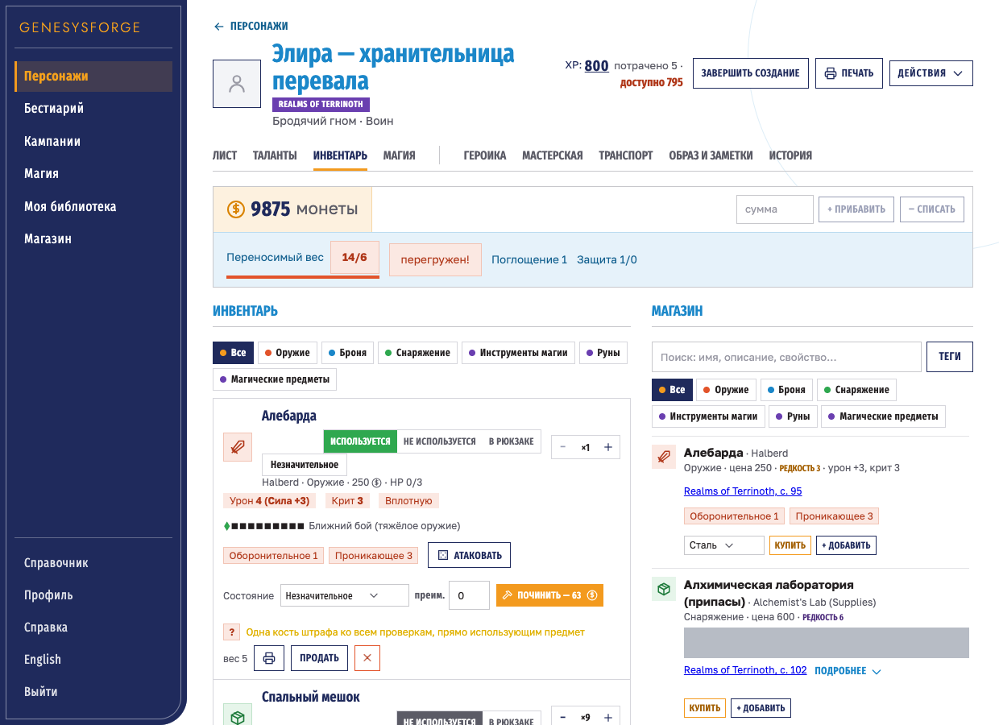 |

Качества атак NPC: компактные поля рейтинга вместо растянутых чипов.

| До, 1240 px | После, 1240 px |
| --- | --- |
| 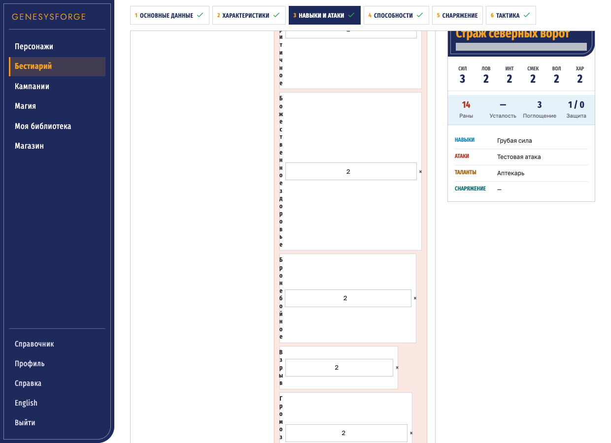 | 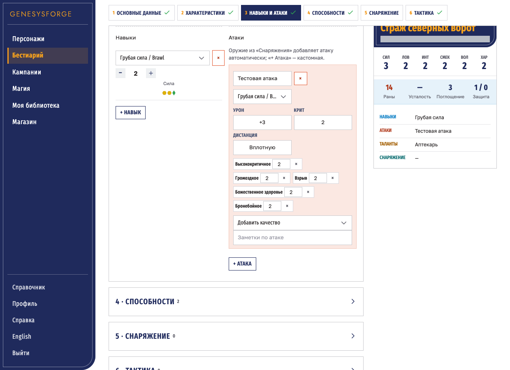 |

| До, 375 px | После, 375 px |
| --- | --- |
| 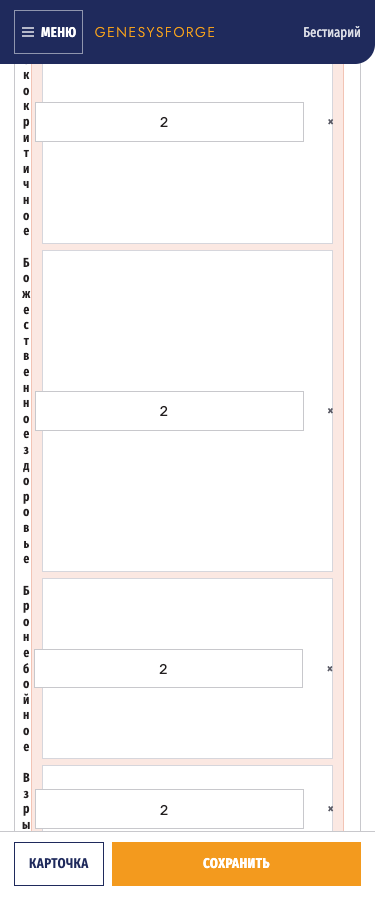 | 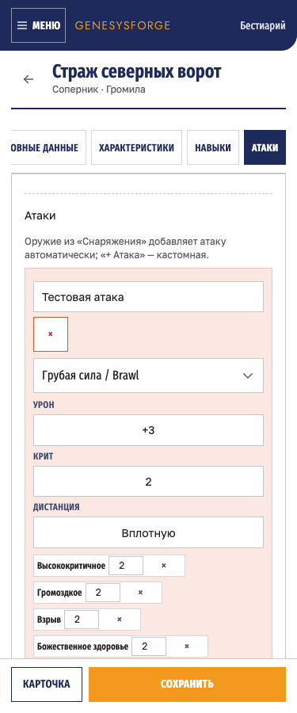 |

Игровой стол, 1240 px: шире левая колонка, круг ограничен по размеру.

| До | После |
| --- | --- |
| 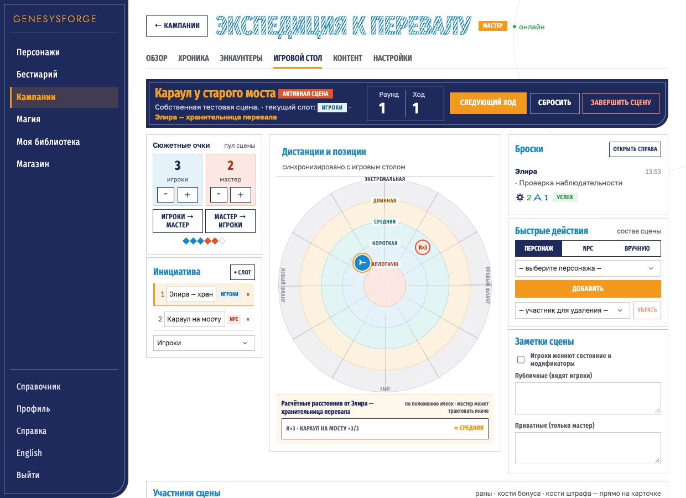 | 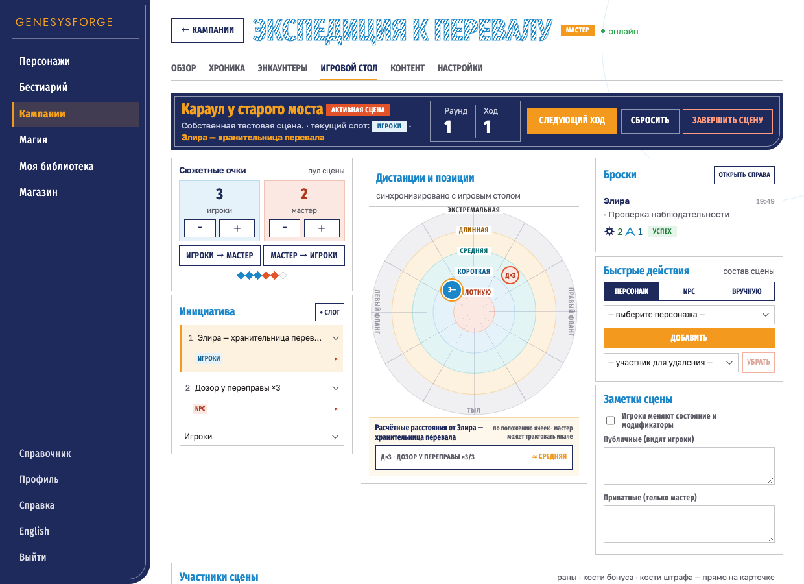 |

Шапка статблока: имя и мета читаются на тёмном фоне.

| До | После |
| --- | --- |
|  |  |

Именное оружие: локализованные урон и дистанция.

| До | После |
| --- | --- |
| 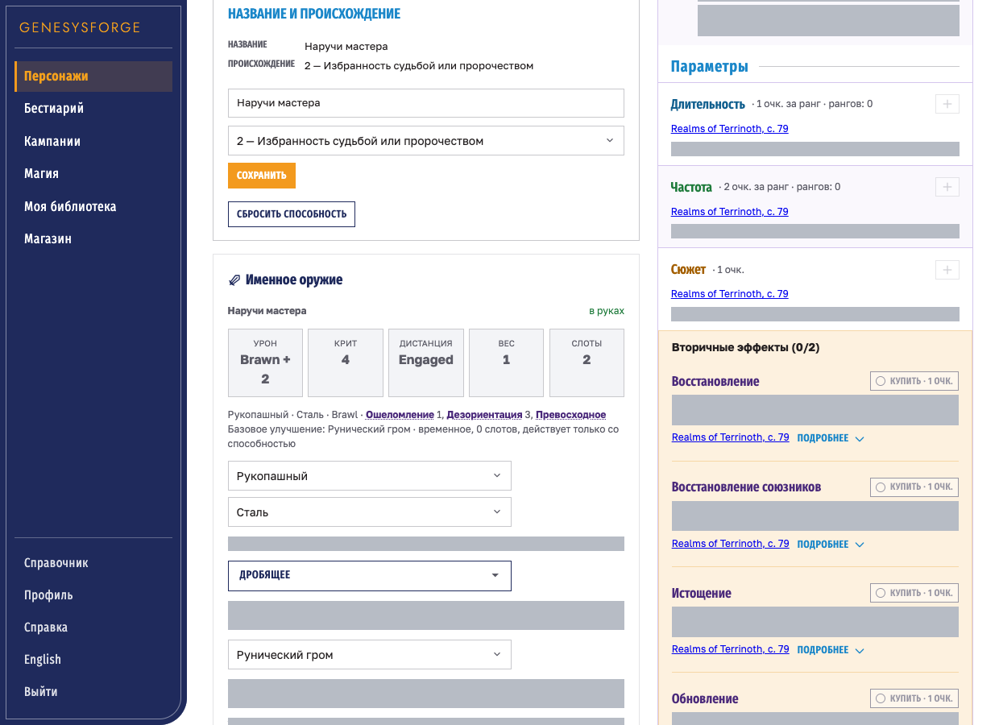 | 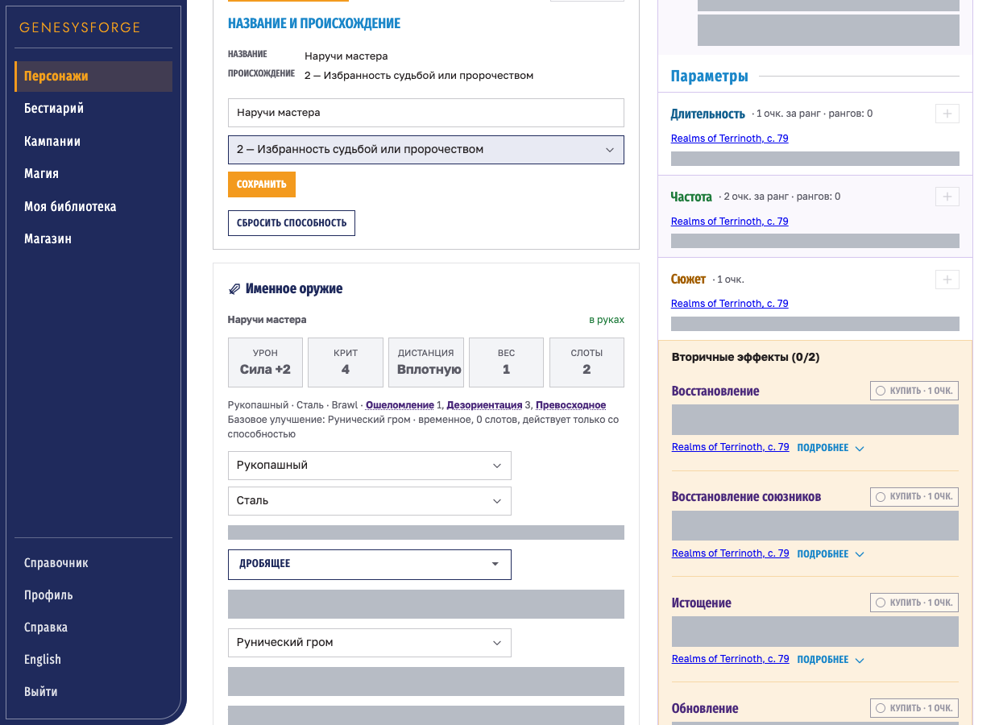 |

Единый список в нативном диалоге, мобильный размер пункта 44 px:

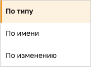
